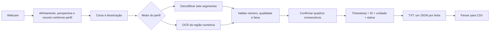

# Leitor de displays por webcam

Base funcional em Python para ler um display numérico, identificar o teste,
gravar registros JSON em um arquivo TXT e converter esse arquivo para CSV.
Há um leitor de sete segmentos e um leitor OCR opcional para outras fontes numéricas.
O novo motor YOLO e o fluxo de coleta, anotação, treinamento e avaliação estão
descritos em [docs/yolo.md](docs/yolo.md). Ele exige pesos treinados para os
caracteres do visor; os exemplos iniciais ainda precisam ser anotados.

A adaptação entre instrumentos é feita por **perfis de calibração**. Cada perfil
define a região do display, dígitos, pontos decimais, sinal e unidade. Você pode
criar, por exemplo, `perfis/multimetro-volts.json` e `perfis/fonte-volts.json`.
Os valores são reconhecidos continuamente. Prefira câmera e instrumento fixos;
com uma imagem de referência, o rastreamento corrige pequenos movimentos.

## Como atende à atividade

| Requisito | Implementação |
| --- | --- |
| Reconhecer os caracteres e convertê-los em dados | OpenCV + sondagem dos sete segmentos; Tesseract opcional para outras fontes |
| Inserir uma identificação de teste | Opção `--test-id` ou pergunta no terminal |
| Unir timestamp, teste, unidade e valor em TXT JSON | Um objeto JSON por linha, com horário Unix do computador |
| Converter o TXT em CSV | Comando `csv`, incluindo validação e número da linha em caso de erro |

## Arquitetura



O limiar pode ser calculado por Otsu ou por regiões locais, conforme a
[documentação do OpenCV](https://docs.opencv.org/4.x/d7/d4d/tutorial_py_thresholding.html).
O reconhecimento de sete segmentos mede sete pequenas regiões em cada célula:

```text
        a
      -----
   f |     | b
      --g--
   e |     | c
      -----
        d
```

O padrão ligado/desligado identifica o dígito. Não é necessário treinar um modelo
para essa primeira versão. Padrões desconhecidos ou ambíguos são rejeitados.
Esse método depende do alinhamento e da geometria dos segmentos na calibração.
O perfil pode retificar segmentos inclinados (`digit_slant`) e definir sete
sondas próprias (`segment_probes`), sem alterar o código para cada instrumento.

Para números em outras fontes, o motor `tesseract` usa OCR com `--psm 7`
(uma linha de texto) e valida o resultado como número. O recorte e o
pré-processamento seguem as orientações de
[qualidade de imagem do Tesseract](https://tesseract-ocr.github.io/tessdoc/ImproveQuality.html).
Não há substituição automática de `O` por `0`, nem remoção de espaços internos:
isso evita transformar uma mensagem ou leitura ambígua em uma medição.

## Instalação

Requisitos: Python 3.10 ou superior, webcam e sessão gráfica para calibrar.
No terminal, dentro desta pasta:

```bash
python3 -m venv .venv
source .venv/bin/activate
python -m pip install -r requirements.txt
```

No Windows, ative o ambiente com `.venv\Scripts\activate`.
Use `opencv-python`, que inclui as janelas necessárias à calibração.

O reconhecimento por segmentos usa apenas as dependências acima. Para o motor
OCR, instale também o executável Tesseract e os dados do idioma `eng`.
Em Ubuntu/Debian:

```bash
sudo apt install tesseract-ocr tesseract-ocr-eng
```

O executável deve estar no `PATH`. O programa o chama diretamente, sem depender
do pacote `pytesseract`.

Opcionalmente, `python -m pip install -e .` instala o comando `display-logger`.
Todos os exemplos abaixo funcionam sem essa instalação, com `python -m display_logger`.

## Demonstração sem câmera

```bash
python -m display_logger demo
```

Isso cria a pasta `demo/` com um perfil, seis imagens e os arquivos
`leituras.txt` e `leituras.csv`. As imagens incluem `24.1`, `-0.08`, `120.0`,
`12.34`, um estado `OL` e um display apagado. Os dois últimos geram valores
nulos com status `invalid`. **Todos esses dados são sintéticos.**
Ao executar novamente na mesma pasta, os registros são acrescentados ao TXT.

Para conferir um único quadro e salvar imagens de diagnóstico:

```bash
python -m display_logger read-image \
  --profile demo/perfil.json \
  --image demo/display-1.png \
  --debug-dir demo/diagnostico
```

O comando retorna código `0` para uma leitura válida e `2` para uma leitura
inválida. Um quadro isolado não passa pela confirmação temporal de `run`.

## Calibrar um multímetro ou fonte

1. Fixe a câmera, deixe o display aproximadamente frontal e evite reflexos.
2. Ajuste foco e iluminação até os segmentos e pontos ficarem legíveis.
3. Escolha a grandeza e a unidade que serão usadas no teste.
4. Execute a calibração e siga as seleções com o mouse.

Exemplo de LCD com quatro posições e caracteres escuros:

```bash
python -m display_logger calibrate \
  --camera 0 \
  --profile perfis/multimetro-volts.json \
  --name multimetro-volts \
  --digits 4 \
  --unit volts \
  --polarity dark
```

Pressione **Espaço** para congelar a imagem. Em cada seleção, arraste um
retângulo e confirme com **Enter** ou **Espaço**.
O teclado precisa estar com o foco na janela da webcam. Enquanto a imagem está
ao vivo, o programa fica aguardando esse comando e ainda não pede as regiões.
Recortes pequenos são ampliados na seleção para facilitar a marcação. A ampliação
não recupera detalhes ausentes: aproxime a câmera se os segmentos estiverem borrados.

- **Display:** inclua dígitos, sinal e pontos; deixe unidade, bordas e ícones fora.
- **Dígitos:** marque da esquerda para a direita a célula completa de cada posição,
  do topo à base dos segmentos. Um `1` ocupa a mesma célula de um `8`:
  não recorte apenas os dois segmentos acesos. Exclua o ponto decimal da célula.
- **Sinal:** marque de perto a região do sinal de menos, mesmo apagado.
  Use `--unsigned` somente se não houver um sinal externo a reconhecer.
- **Pontos:** selecione cada posição em que um separador decimal pode aparecer,
  mesmo que esteja apagado na imagem. Use **ESC** apenas para posições inexistentes.
  Recorte cada ponto de perto, sem incluir o dígito vizinho.

Pontos e sinal são detectados pela ocupação da região selecionada. Uma caixa
grande demais pode impedir sua detecção. O perfil registra coordenadas
normalizadas; mudar a resolução preservando o mesmo enquadramento pode funcionar,
mas mudanças grandes de posição ou perspectiva exigem nova calibração.

Ao salvar o perfil, o programa também grava uma imagem com o mesmo nome e o
sufixo `.referencia.png`, e tenta ler esse quadro. Uma rejeição nessa conferência
é exibida no terminal para que você ajuste o enquadramento antes do ensaio.
O perfil novo habilita o rastreamento com essa referência. Mantenha os dois
arquivos juntos ao copiar ou mover um perfil. `--no-tracking` desativa essa etapa.

O rastreamento busca a moldura e a etiqueta ao redor do display, excluindo os
dígitos que mudam, com
[correspondência de imagens do OpenCV](https://docs.opencv.org/4.x/de/da9/tutorial_template_matching.html).
Depois, estima um alinhamento afim antes da leitura. Se perder a moldura ou o
alinhamento exceder os limites, registra `invalid` e reinicia a estabilização.

Para LCDs com segmentos inclinados, `--digit-slant 0.25` indica um deslocamento
horizontal de 25% da largura da célula entre topo e base; valores negativos
representam inclinação oposta. Esse parâmetro descreve a geometria dos
segmentos dentro da célula, independentemente do movimento da câmera.
`--otsu-offset -3` reduz em três níveis de cinza o limiar automático de Otsu.
Use ajustes baseados nas imagens de diagnóstico; um limiar inadequado pode
apagar segmentos ou realçar segmentos inativos do LCD.

O campo opcional `segment_probes` contém sete objetos `x`, `y`, `w`, `h`, em
coordenadas normalizadas **dentro da célula retificada**, na ordem `a,b,c,d,e,f,g`.
O perfil `perfis/multimetro.json` foi ajustado para o LCD real capturado neste
projeto; os perfis de demonstração continuam usando a geometria padrão.

Para recalibrar a posição do mesmo LCD, use `--from-profile perfis/multimetro.json`
no comando `calibrate`. Essa opção reutiliza as sondas dos segmentos, a inclinação,
o ajuste de Otsu e a busca local dos segmentos, enquanto você seleciona novamente display, dígitos, sinal e
pontos decimais. `--digit-slant` e `--otsu-offset`, quando informados, substituem
os ajustes herdados. O perfil de origem pode ser o mesmo caminho de `--profile`:
ele é lido antes da seleção e só é salvo novamente ao concluir a calibração.

`--segment-search 0.06` permite buscar o traço em uma vizinhança de até 6% da
largura e da altura da célula ao redor de cada sonda. Isso acomoda pequenas
diferenças de espessura, alinhamento e posição dos segmentos entre dígitos. A
janela mantém seu tamanho, e os padrões e limiares continuam sendo validados;
o leitor não completa um dígito pelo padrão mais parecido. O ajuste fica salvo
em `segment_search` e é herdado por `--from-profile`. O valor máximo é 0.10.
Os diagnósticos desenham a posição efetivamente utilizada em cada sonda.

Para um display com segmentos claros sobre fundo escuro, use `--polarity light`.
Para iluminação desigual, experimente `--threshold adaptive` e confira os resultados.
Também é possível calibrar uma foto com `--image caminho/foto.png` em vez de `--camera`.

### Corrigir a perspectiva antes de selecionar os números

Use `--perspective` para marcar os quatro cantos do visor no quadro congelado:

```bash
python -m display_logger calibrate \
  --camera 0 --camera-backend v4l2 \
  --perspective \
  --from-profile perfis/multimetro.json \
  --profile perfis/multimetro-perspectiva.json \
  --digits 4 --unit volts
```

Após pressionar Espaço na webcam, clique nos cantos nesta ordem:
**superior esquerdo → superior direito → inferior direito → inferior esquerdo**.
Inclua o visor completo, com espaço para sinal e pontos. Enter confirma os quatro
pontos, Backspace desfaz o último, R limpa e ESC cancela. Um quadrilátero com
pontos repetidos, lados cruzados ou pontos colineares é recusado.

O programa usa uma homografia com `getPerspectiveTransform` e `warpPerspective`,
conforme a [documentação do OpenCV](https://docs.opencv.org/4.x/da/d6e/tutorial_py_geometric_transformations.html).
A imagem resultante aparece frontal. Selecione nela a ROI dos números e, depois,
as células dos dígitos, o sinal e os pontos como na calibração normal.

O perfil guarda os cantos na imagem da câmera, o tamanho retificado e as regiões
no plano frontal. A referência `.referencia.png` permanece como quadro da câmera;
`.retificado.png` permite conferir a correção aplicada. O reconhecimento executa
essa transformação automaticamente antes do recorte, em `run` e `read-image`.
O diagnóstico também salva `retificado.png` e informa `roi_space: rectified`.

```bash
python -m display_logger run \
  --profile perfis/multimetro-perspectiva.json \
  --test-id teste-perspectiva --out logs/teste-perspectiva.txt
```

Ao recalibrar com `--from-profile`, a etapa dos quatro cantos é repetida se o
perfil de origem já utiliza perspectiva. `--no-perspective` permite desativá-la.
O rastreamento continua operando no quadro da câmera; a correção de perspectiva
é aplicada depois do alinhamento. Isso não substitui um detector global de visor:
mudanças grandes de posição ou de ângulo ainda podem exigir novos cantos.

Se o instrumento **sempre** tem um número fixo de casas decimais, por exemplo
uma fonte configurada para duas casas, pode usar `--decimals 2`. Nesse modo o
ponto não é detectado: `0241` vira `2.41` por configuração. Para leitura sem
casas decimais, use `--no-decimal`. Mantenha o modo padrão de detecção quando
a posição do ponto puder mudar.

O argumento `--require-decimal` rejeita leituras sem ponto quando o instrumento
sempre deve apresentar um. Limites opcionais, como `--value-min 0 --value-max 30`,
rejeitam valores fora da faixa esperada.

## Display moderno com outras fontes

Selecione apenas uma linha de valor numérico, incluindo sinal e separador:

```bash
python -m display_logger calibrate \
  --camera 0 \
  --profile perfis/fonte-ocr.json \
  --unit volts \
  --engine tesseract \
  --polarity dark
```

Nesse motor, não é necessário selecionar células individuais. O reconhecimento
efetivo depende da fonte, do contraste e da resolução e precisa ser conferido no
equipamento real. Uma tela com tensão e corrente requer um perfil/recorte para
cada valor; esta versão lê um recorte por execução.

## Registrar um teste

```bash
python -m display_logger run \
  --camera 0 \
  --profile perfis/multimetro-volts.json \
  --test-id teste-cliente-a-001 \
  --interval 1 \
  --stable-frames 3 \
  --out logs/ensaio-001.txt
```

Se omitir `--test-id`, a identificação será solicitada no terminal.
Após alterar o código ou o perfil, encerre a captura e execute o comando novamente:
o processo carrega a configuração na inicialização.
O programa processa os quadros recebidos continuamente e grava no máximo um
registro por intervalo. O mesmo valor precisa aparecer em três quadros
consecutivos para ter status `ok`. Isso reduz erros transitórios, mas não
comprova a exatidão de uma leitura persistentemente errada.

Pressione **Q** na janela ou **Ctrl+C** no terminal para encerrar.
Durante a captura, a janela mostra a câmera inteira com o retângulo do perfil
e o recorte ampliado ao lado. Se o retângulo incluir bordas ou botões, refaça a
calibração na posição atual do instrumento.

Outras opções:

- `--duration 60`: executa por aproximadamente 60 segundos.
- `--samples 100`: encerra após 100 registros, incluindo falhas.
- `--no-preview`: captura sem abrir janela, usando um perfil já calibrado.
- `--no-tracking`: usa as regiões fixas, sem alinhar com a imagem de referência.
- `--debug-dir logs/diagnostico`: salva imagens de falhas quando o motivo muda,
  no máximo uma vez por intervalo de registro.
- `--camera 1`: tenta outra webcam.
- `--video arquivo.avi`: testa com vídeo gravado; usa timestamps da execução atual.

Os valores permanecem em branco/nulos enquanto estiverem instáveis ou inválidos.
Uma falha reinicia a confirmação; o último valor válido não é reutilizado.
Se a câmera parar de fornecer quadros, uma falha é registrada e a execução termina.

Pressione **S** na janela para salvar o quadro atual, o enquadramento, o recorte,
a máscara e imagens das sondas de cada dígito. Com `--out logs/teste.txt`, o destino
padrão é `logs/teste-diagnostico/`; `--debug-dir` permite escolher outra pasta.
O arquivo `diagnostico.json` registra a ocupação de cada segmento e a leitura.
Isso permite distinguir um dígito desconhecido de uma região selecionada fora
do visor. O comando `read-image --debug-dir` gera os mesmos diagnósticos.
Com rastreamento ativo, `original.png` guarda a imagem da câmera e `alinhado.png`
guarda a imagem corrigida usada para recortar e reconhecer o display.

### Avisos de webcam no Linux

No Linux, a abertura automática prioriza V4L2 para webcams locais. Se ele não
conseguir abrir o dispositivo, o programa tenta a seleção automática do OpenCV.
O terminal informa o backend que abriu a câmera. Você também pode escolhê-lo
explicitamente com `--camera-backend v4l2` ou `--camera-backend gstreamer`, nos
comandos `calibrate` e `run`. Arquivos de vídeo mantêm seleção automática.
Veja a documentação de
[seleção de backends do OpenCV](https://docs.opencv.org/4.x/d8/dfe/classcv_1_1VideoCapture.html).

Os avisos do GStreamer sobre posição de vídeo e propriedades não implementadas
não demonstram, por si só, uma falha de captura. O programa configura o tamanho
do buffer apenas quando o backend efetivo é V4L2.

Se aparecer `QSocketNotifier: Can only be used with threads started with QThread`,
confira o comportamento da janela: quando a imagem está aparecendo e responde
ao teclado, o aviso não impediu essa etapa da calibração. Clique na janela e
pressione **Espaço** para avançar. Esse aviso é emitido pela camada Qt da interface;
ele não indica, por si só, um problema no reconhecimento dos números.

## Formato do TXT

O arquivo contém **um objeto JSON completo por linha**, em UTF-8 (formato JSONL).
Não é um único array JSON. As quatro chaves solicitadas na atividade estão
presentes; campos adicionais permitem identificar a qualidade de cada registro:

```json
{"timestamp":1800000000.25,"id-teste":"teste-cliente-a-001","unidade medida":"volts","value":24.1,"status":"ok","confidence":0.9,"raw":"24.1","reason":"","profile":"multimetro-volts"}
{"timestamp":1800000001.25,"id-teste":"teste-cliente-a-001","unidade medida":"volts","value":null,"status":"invalid","confidence":0.0,"raw":"","reason":"Imagem sem contraste suficiente.","profile":"multimetro-volts"}
```

- `timestamp`: segundos Unix, com fração, obtidos no computador logo após a captura.
  Não é um timestamp fornecido pelo instrumento; depende do relógio e da latência da câmera.
- `value`: número na unidade do perfil; `null` em falhas ou durante estabilização.
- `status`: `ok`, `unstable` ou `invalid`. O primeiro registro pode ser `unstable`.
- `raw`: texto reconhecido; preserva casas decimais e zeros quando disponíveis.
- `confidence`: indicador heurístico de qualidade, **não uma probabilidade de acerto**.
  Nos segmentos é a margem de ativação; no OCR vem do Tesseract.
- `reason`: motivo da rejeição ou da espera por estabilização.

O TXT é aberto em modo de acréscimo e descarregado após cada linha. Isso não
equivale a uma garantia de persistência diante de queda de energia.
Um arquivo existente sem quebra de linha final é recusado, para evitar juntar
um novo registro a uma linha possivelmente interrompida.

## Converter para CSV

```bash
python -m display_logger csv \
  --input logs/ensaio-001.txt \
  --output logs/ensaio-001.csv
```

Para usar ponto e vírgula como separador de colunas:

```bash
python -m display_logger csv \
  --input logs/ensaio-001.txt \
  --output logs/ensaio-001.csv \
  --delimiter ';'
```

O separador decimal dos valores continua sendo ponto. O CSV usa UTF-8 com BOM
para facilitar a abertura em planilhas e mantém as linhas inválidas com valor
vazio e seu status. Filtre `status=ok` antes de calcular médias ou outras métricas.

O conversor também aceita o formato original com apenas as quatro chaves e
números escritos como strings, por exemplo `"value":"24.1"`. Se encontrar
uma linha inválida, informa o número da linha e preserva um CSV de saída que
já exista. O arquivo de saída só é substituído após a conversão completa.

## Escopo e validação na bancada

Esta base implementa captura, rastreamento local e reconhecimento configurável.
O rastreador depende da moldura de referência e tolera pequenos deslocamentos,
inclinações e mudanças de escala. Uma troca de instrumento ou movimentos grandes
exigem nova calibração. A detecção de qualquer instrumento em posições arbitrárias
exige um detector adicional. Fontes com outras geometrias podem exigir ajuste das
sondas no perfil ou uso do motor OCR.

**A unidade é informada pelo operador e fica fixa no perfil.** A versão atual
não identifica automaticamente V, mV, A, mA, AC/DC nem converte prefixos.
Para a primeira bancada, fixe a função e a unidade do instrumento. Se houver
mudança automática de prefixo, acrescente regiões de leitura desses indicadores
e valide-as junto com o número antes de usar os registros.

Estados como `OL`, caracteres não numéricos reconhecidos pelo OCR, padrões de
segmentos desconhecidos e imagens sem contraste são rejeitados. A detecção não
garante identificar todos os estados possíveis: símbolos fora do recorte ou
segmentos confundidos com um dígito válido exigem validação com imagens reais.
Um ponto ou sinal que desapareça na imagem também pode alterar um número válido.
Use enquadramento adequado, `--require-decimal` quando aplicável e limites do perfil.

Antes de entregar a atividade, grave amostras reais de cada equipamento contendo
todos os dígitos, diferentes pontos, sinais, valores próximos de zero, alterações
de leitura e falhas visuais. Compare com anotações manuais e meça:

| Verificação | O que medir |
| --- | --- |
| Leitura completa | Número, sinal e ponto corretos juntos por quadro rotulado |
| Erro aceito | Leituras incorretas que receberam status `ok` |
| Rejeição | Quadros sem leitura válida sobre o total |
| Tempo | Latência para confirmar mudanças e intervalo efetivo dos registros |
| Exportação | Correspondência de IDs, timestamps, unidades e valores entre TXT e CSV |

Defina os critérios de aceitação com o responsável pela atividade. As imagens
sintéticas verificam o software, mas não medem desempenho no multímetro ou fonte.
A calibração gráfica e a exatidão das medições precisam ser verificadas na
webcam e no instrumento usados no ensaio.

## Organização e testes

```text
display_logger/
  config.py       Perfis e validação das regiões
  vision.py       Pré-processamento, segmentos, OCR e confirmação temporal
  records.py      TXT JSONL e parser CSV
  diagnostics.py  Enquadramento, imagens de diagnóstico e sondas dos segmentos
  tracking.py     Localização da moldura e alinhamento com a imagem de referência
  geometry.py     Homografia do visor e conversão de coordenadas da ROI
  cli.py          Calibração e comandos de operação
  synthetic.py    Gerador de imagens e demonstração
tests/            Testes de visão, registros e comandos
```

Para executar os testes:

```bash
python -m pip install pytest
python -m pytest -q
```

Os testes incluem dígitos, decimais, sinal, duas polaridades, alteração de
resolução, ruído moderado, rejeições, estabilidade e integridade da exportação.
Há uma integração com o executável Tesseract, executada quando ele está instalado.
Também há imagens reais do LCD para verificar `0.009`, `0.000` e o alinhamento
após um pequeno movimento. Essas amostras cobrem apenas as condições capturadas;
não substituem a validação das demais faixas, sinais e dígitos no instrumento.
Os testes de perspectiva incluem uma cena projetada em um quadrilátero inclinado,
reconhecimento após a retificação, validação dos cantos, persistência do perfil,
seleção da ROI no plano frontal e integração com o rastreamento.
